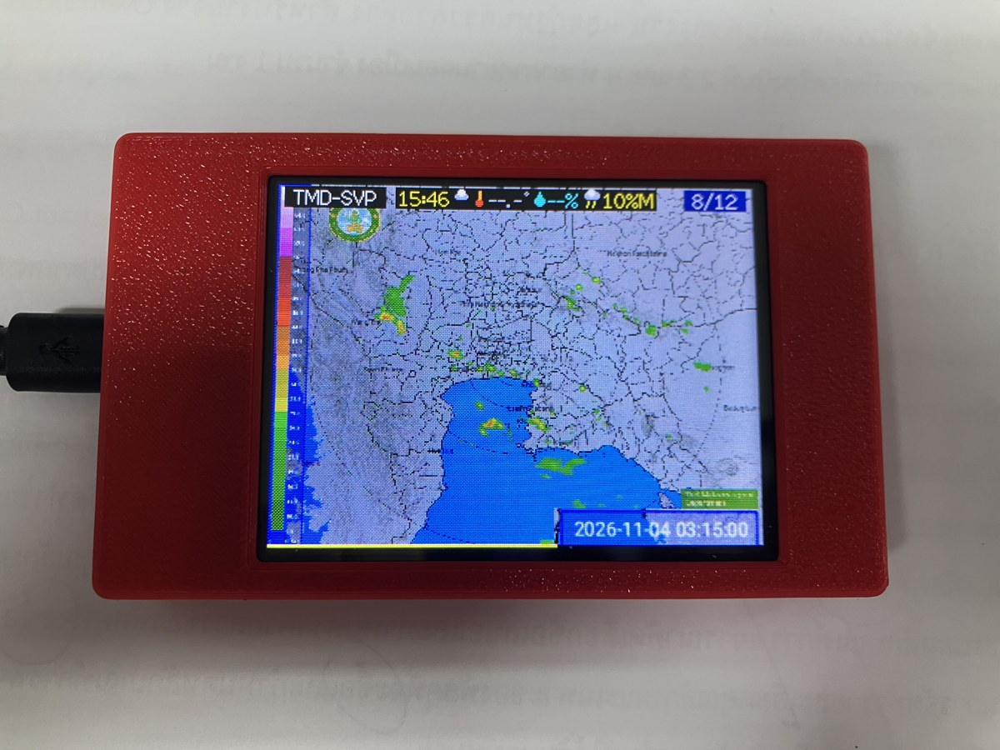
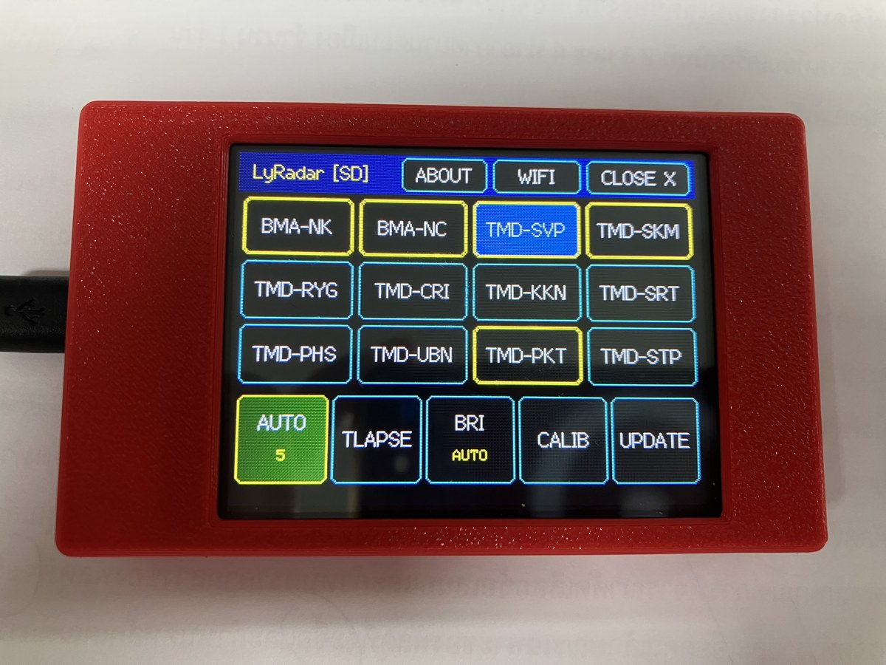

# LyRadar CYD 🌦️📡

**Live Weather Radar Display for ESP32-2432S028 (Cheap Yellow Display - CYD)**

[](LICENSE)
[](https://docs.platformio.org/page/boards/espressif32/esp32dev.html)
[](https://www.arduino.cc/)
[](https://github.com/zotix/LyRadar/releases)

---

<div align="center">
  
  
  <p><em>หน้าจอแสดงผลสดเรดาร์ตรวจอากาศ (TMD-SVP สุวรรณภูมิ 240km) และหน้าจอสัมผัสควบคุม 12 สถานีเรดาร์ทั่วไทย บนบอร์ด ESP32-2432S028 (CYD)</em></p>
</div>

---

## 📖 ภาพรวมโครงการ (Overview)

**LyRadar CYD** คือเฟิร์มแวร์แสดงผลภาพเรดาร์ตรวจอากาศแบบเคลื่อนไหว (Animated Weather Radar Loops) สำหรับบอร์ด **ESP32-2432S028 (CYD)** หน้าจอสีสัมผัสขนาด 2.8 นิ้ว 

ออกแบบสถาปัตยกรรมระดับฮาร์ดแวร์โดยใช้ **Dual-Core FreeRTOS**, หน่วยความจำแคช **Double-Buffered Flash (2.75 MB)** ร่วมกับ **MicroSD Card Pre-Caching** เพื่อให้การเล่นภาพแอนิเมชัน 12 เฟรมลื่นไหลระดับ 350ms ไม่มีอาการกระตุกหรือจอดำ พร้อมระบบประหยัดพลังงานอัจฉริยะ (Deep Power Optimization)

---

## ✨ คุณสมบัติเด่น (Key Features)

- 📡 **รองรับ 12 สถานีเรดาร์ทั่วประเทศไทย**:
  - **กรุงเทพฯ และปริมณฑล (กทม. BMA)**: หนองแขม (`NK`), หนองจอก (`NC`)
  - **กรมอุตุนิยมวิทยา (TMD)**: สุวรรณภูมิ 240km (`SVP`), สมุทรสงคราม (`SKM`), ระยอง (`RYG`), เชียงราย (`CRI`), ขอนแก่น (`KKN`), อุบลราชธานี (`UBN`), พิษณุโลก (`PHS`), สุราษฎร์ธานี (`SRT`), ภูเก็ต (`PKT`), สทิงพระ สงขลา (`STP`)
- 🔍 **โหมดซูมเต็มรูปแบบ 12 เฟรม (Full 12-Frame HD Zoom & Instant Zoom)**:
  - แตะจุดไหนบนแผนที่ ซูมเข้าจุดนั้นทันทีแบบไร้รอยต่อ ไม่มีข้ามเฟรม ด้วยความเร็ว 350ms
  - ระบบ Pre-caching เบื้องหลังสร้างไฟล์ไบนารี HD Zoom 1:1 (`.z12`) เก็บลง MicroSD Card เพื่อความคมชัดสูงสุด
- 🌤️ **แถบสภาพอากาศสด Top HUD Weather Bar**:
  - ดึงข้อมูลสภาพอากาศแบบ Real-time จาก Open-Meteo API อ้างอิงพิกัดสถานี
  - พิกเซลไมโครไอคอนสภาพอากาศ (☀️, ⛅, 🌧️, ⛈️), อุณหภูมิ, ความชื้น และเปอร์เซ็นต์ฝนพร้อมแท็กความแรง (`L`, `M`, `H`)
  - เรนเดอร์ลงใน Sprite Buffer ทุกๆ 350ms แบบ Zero-Flicker ไร้การกระพริบ
- 🎯 **ระบบ Station Playlist Filter (ขอบสีเหลือง)**:
  - กดค้างที่ปุ่มสถานีใดๆ ในหน้าเมนู เพื่อเลือกเฉพาะสถานีที่ต้องการเข้า Playlist
  - โหมด AUTO จะวนลูปเล่นเฉพาะสถานีที่เลือกไว้ พร้อมแสดงตัวเลขจำนวนสถานีที่ปุ่ม `AUTO`
- 🔘 **ปุ่มเมนูอัจฉริยะ 2 บรรทัด (2-Line Action Buttons)**:
  - ปุ่ม `AUTO`: แสดงสถานะการวนลูปและจำนวนสถานีใน Playlist (เช่น `AUTO 5`, `AUTO ALL`, `AUTO OFF`)
  - ปุ่ม `BRI`: แสดงระดับความสว่างหน้าจอปัจจุบัน (`AUTO`, `100%`, `55%`, `20%`)
- 🚀 **Background Pre-Caching ลง MicroSD Card**:
  - Core 0 ทยอยดาวน์โหลดแคชเก็บไว้ที่ `/ly-radar/cache/sta_<id>.gif` เบื้องหลัง
  - สลับเปลี่ยนสถานีได้ทันทีในเวลา **< 0.3 วินาที** จาก SD Card โดยไม่ต้องรอโหลดเน็ตใหม่
- 🔄 **โหมด AUTO วนลูปสลับสถานีอัตโนมัติ (Kiosk Slideshow)**:
  - สลับสถานีทุกๆ 30 วินาที พร้อมระบบข้ามสถานีที่ยังโหลดไม่เสร็จ (Skip unready)
  - หน้าจอ Clean Display ซ่อนป้ายเทคนิค คงไว้เฉพาะป้ายแจ้งเตือนสภาพอากาศ `RAIN XX%`
  - หยุดวนลูปชั่วคราวเมื่อแตะซูม และมี Inactivity Watchdog 3 นาทีกลับสู่โหมด AUTO อัตโนมัติ
- 🍃 **ระบบประหยัดพลังงานขั้นสูง (Deep Power Optimization v1.3.0)**:
  - **WiFi Modem-Sleep (`WIFI_PS_MIN_MODEM`)**: ชิปวิทยุหลับระหว่างรอบ DTIM Beacon ลดกระแส WiFi ลงจาก ~100 mA เหลือเพียง **~15–20 mA**
  - **Hybrid Clock Scaling (80 ↔ 240 MHz)**: วิ่งที่ 80 MHz ช่วงเล่นภาพ/สแตนด์บาย (APB bus 80 MHz เต็มสปีด SPI) และบูสต์ 240 MHz เฉพาะช่วงดาวน์โหลด HTTPS และถอดรหัส
  - **Smart Eco Standby**: หรี่ไฟจอลงสู่ duty 30 (~12%) อัตโนมัติเมื่อไม่มีการแตะจอเกิน 3 นาทีและไม่มีฝนตก พร้อมตื่นทันทีเมื่อแตะหน้าจอ กดปุ่ม หรือตรวจพบฝนตก $\ge 1\%$
  - **ประหยัดพลังงานรวมสูงสุดถึง ~65%** (กินกระแสปกติเพียง **~75–90 mA @ 5V** เทียบกับเดิม ~250–280 mA) ชิปเย็นลงอย่างเห็นได้ชัด
- ⌨️ **On-Screen WiFi Scanner & 5-Row Touch Keyboard**:
  - สแกนหาคลื่น 2.4 GHz บนหน้าจอ พร้อมคีย์บอร์ดสัมผัส 5 แถวที่มีแถวตัวเลข 0–9 กดง่ายไม่ต้องสลับโหมด
  - รองรับการตั้งค่า WiFi อัตโนมัติผ่านไฟล์ `/ly-radar/wifi.txt` บน MicroSD Card
- 🔘 **ปุ่มลัดฮาร์ดแวร์ (Physical BOOT Button - GPIO 0)**:
  - กดสั้น (< 3s): ปิดเมนู หรือหมุนหน้าจอ 0° / 180°
  - กดค้าง 3s..9s: เข้าสู่หน้า 3-Point Touch Calibration
  - กดค้าง $\ge 10$s: สลับโหมดสีจอ Invert Display

---

## 🛠️ ฮาร์ดแวร์ที่รองรับ (Supported Hardware)

- **ESP32-2432S028** (บอร์ด Cheap Yellow Display - CYD หน้าจอ 2.8 นิ้ว 320×240)
  - รุ่น 2-USB (ชิปจอ ST7789, ทัช XPT2046) — *Environment หลัก: `cyd_2usb_st7789`*
  - รุ่น 1-USB (ชิปจอ ILI9341, ทัช XPT2046) — *Environment: `cyd_1usb_ili9341`*
- **MicroSD Card**: ฟอร์แมตแบบ FAT32 เสียบเข้าช่องด้านหลังบอร์ด (เชื่อมต่อผ่านขา VSPI)

ดูรายละเอียดพินทั้งหมดได้ที่ [docs/hardware_notes.md](docs/hardware_notes.md)

---

## 📦 โครงสร้างไฟล์ใน MicroSD Card (`/ly-radar/`)

```text
SD Card Root/
└── ly-radar/
    ├── wifi.txt          # ตั้งค่า WiFi อัตโนมัติ (บรรทัด 1 = SSID, บรรทัด 2 = Password)
    ├── log.txt           # บันทึกสถานะการบูตและการเชื่อมต่อ
    ├── rain.csv          # สถิติปริมาณฝนสะสม
    ├── zoom/             # แคชภาพ 12 เฟรม HD Zoom 1:1 (.z12)
    └── cache/            # แคชภาพเรดาร์แต่ละสถานี (sta_0.gif .. sta_11.gif)
```

---

## 💻 วิธีการคอมไพล์และติดตั้ง (Build & Flash)

โปรเจกต์นี้พัฒนาบน **PlatformIO** แนะนำให้ติดตั้ง PlatformIO IDE หรือ PlatformIO Core CLI:

```bash
# 1. Clone repository
git clone https://github.com/zotix/LyRadar.git
cd LyRadar

# 2. คอมไพล์และอัปโหลดสำหรับรุ่น 2-USB (ST7789)
pio run -e cyd_2usb_st7789 -t upload

# หรือสำหรับรุ่น 1-USB (ILI9341)
pio run -e cyd_1usb_ili9341 -t upload
```

---

## 📜 ข้อกำหนดลิขสิทธิ์และการจำหน่าย (License Terms)

ลิขสิทธิ์ซอฟต์แวร์เป็นของ **© 2026 Zotix. All Rights Reserved.**

### 1. การใช้งานส่วนบุคคล (Personal / Non-Commercial Use) — ฟรี 100%
อนุญาตให้บุคคลทั่วไปดาวน์โหลด ดัดแปลง คอมไพล์ และแฟลชลงบอร์ดของตนเอง เพื่อการศึกษา ค้นคว้า หรือใช้งานส่วนตัวภายในบ้านได้ฟรี

### 2. เงื่อนไขเชิงพาณิชย์ (Commercial Use) — ⚠️ ต้องซื้อไลเซนส์
**ห้ามมิให้นำซอฟต์แวร์หรือเฟิร์มแวร์นี้ไปใช้ในเชิงพาณิชย์ แฟลชใส่บอร์ดสำเร็จรูปเพื่อวางจำหน่าย (เช่น Shopee, Lazada, TikTok Shop, หน้าร้าน) หรือแสวงหากำไรโดยเด็ดขาด**

> **ต้องการนำไปผลิตจำหน่ายเชิงพาณิชย์?**  
> หากต้องการสิทธิ์ในการจำหน่ายตัวบอร์ดที่แฟลชเฟิร์มแวร์นี้ **ต้องติดต่อขอซื้อ Commercial License จากผู้พัฒนา (Zotix) ก่อนนำไปจำหน่ายทุกกรณี**  
> ติดต่อสอบถามได้ที่: [https://github.com/zotix/LyRadar/issues](https://github.com/zotix/LyRadar/issues)

อ่านรายละเอียดฉบับเต็มได้ที่ไฟล์ [LICENSE](LICENSE)

---

## ☕ สนับสนุนผู้พัฒนา (Buy Me a Coffee)

หากคุณชื่นชอบโปรเจกต์ **LyRadar CYD** และต้องการร่วมสนับสนุนค่าน้ำค่ากาแฟในการพัฒนาต่อยอด สามารถร่วมสนับสนุนผ่านระบบ **PromptPay** ได้โดยตรง:

<div align="center">
  
  <br>
  <em>สแกนผ่านแอปพลิเคชันธนาคารเพื่อสนับสนุนผู้พัฒนา (Zotix) ☕</em>
</div>

- หรือสแกน QR Code PromptPay ได้โดยตรงจากหน้า **`[ABOUT]`** บนหน้าจอบอร์ด CYD

---

## 🙏 กิตติกรรมประกาศ (Acknowledgements)

- **สำนักการระบายน้ำ กรุงเทพมหานคร (BMA)**: ข้อมูลภาพเรดาร์ตรวจสภาพอากาศหนองแขมและหนองจอก
- **กรมอุตุนิยมวิทยา (TMD)**: ข้อมูลภาพเรดาร์ตรวจสภาพอากาศ 10 สถานีภูมิภาคทั่วประเทศ
- **Bodmer / TFT_eSPI**: ไลบรารีเรนเดอร์กราฟิกหน้าจอ TFT และระบบ Sprite Buffer
- **Espressif Systems**: แพลตฟอร์ม ESP32, FreeRTOS และชุดพัฒนา Arduino Core
